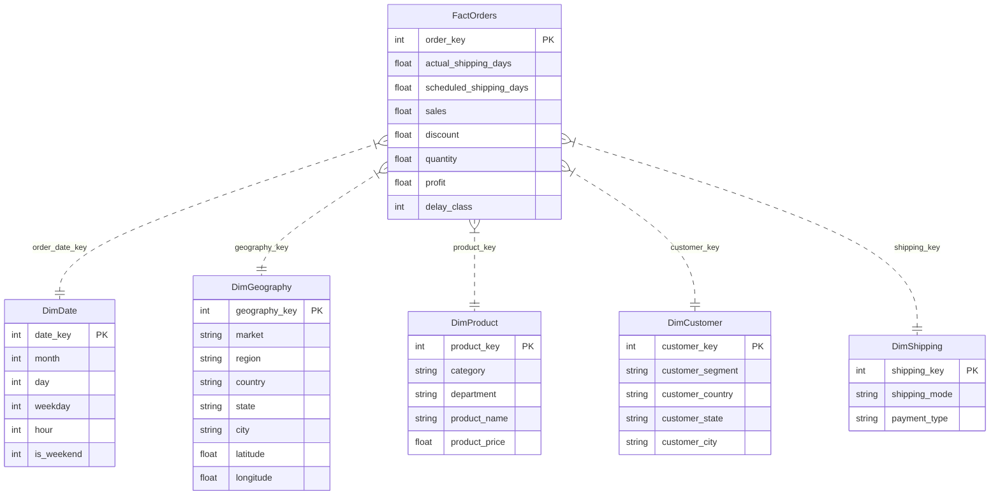

# Smart Freight: Shipping Days Prediction & Logistics Analytics Platform
## College Mini-Project & Academic DWM Laboratory Documentation

---

## 1. Project Objective

In global supply chain management, delivery delays and inaccurate transit estimations erode customer satisfaction and cause operational penalties. 

The primary business and academic objectives of this project are:
1. **Primary Regression Target:** Accurately predict `Days for shipping (real)` prior to shipment fulfillment using only attributes available at order creation time.
2. **Data Leakage Prevention:** Strictly exclude post-fulfillment outcome attributes (`Late_delivery_risk`, `Delivery Status`, `shipping date (DateOrders)`, `Shipping delays`) that artificially inflate accuracy through retrospective data leakage.
3. **Dedicated DWM Academic Laboratory (`/academic`):** Provide an end-to-end practical laboratory covering Data Warehousing (Star/Snowflake/Constellation schemas, OLAP cubes) and Data Mining (Linear & Tree Regressors, Classification with SMOTE, K-Means Clustering, and Apriori Association Rule Mining).
4. **Operational Web Platform:** Deploy a modern logistics SaaS dashboard with interactive single/batch prediction, SQLite persistence, and operational KPI tracking.

---

## 2. Dataset Explanation

The platform is trained and evaluated on the cleaned **DataCo Supply Chain dataset**:
- **Total Records:** 59,606 transactions
- **Total Attributes:** 35 features
- **Domain:** Multi-national retail logistics and omni-channel fulfillment

### Key Attribute Categories:
- **Order Attributes:** `Days for shipment (scheduled)`, `Type` (DEBIT, TRANSFER, PAYMENT, CASH), `order_month`, `order_day`, `order_weekday`, `order_hour`, `is_weekend`
- **Shipping Attributes:** `Shipping Mode` (Standard Class, Second Class, First Class, Same Day)
- **Geography:** `Market` (Europe, Pacific Asia, LATAM, USCA, Africa), `Order Region`, `Order Country`, `Order State`, `Latitude`, `Longitude`
- **Product & Commercials:** `Category Name`, `Department Name`, `Order Item Quantity`, `Sales`, `Order Item Discount`, `Product Price`
- **Primary Target:** `Days for shipping (real)` (continuous / discrete days in transit)

---

## 3. Data Warehouse Architecture & Schema Design (Labs 1–3)

The logistics data warehouse is structured into a multi-dimensional constellation:

### Schema Comparisons:
- **Star Schema:** Denormalized dimensions directly referencing `FactOrders`, optimizing read queries and OLAP aggregations.
- **Snowflake Schema:** Dimensions normalized into sub-tables (e.g. `DimGeography` -> `DimCountry` -> `DimMarket`), reducing data redundancy.
- **Fact Constellation (Galaxy Schema):** Multiple fact tables (`FactOrders`, `FactInventory`, `FactShipments`) sharing common conformed dimensions (`DimProduct`, `DimDate`).

---

## 4. Preprocessing Steps & Machine Learning Pipeline

1. **Continuous Feature Processing:**
   - Handled via `SimpleImputer(strategy='median')` to maintain robustness against shipping outlier delays.
2. **Categorical Feature Processing:**
   - Encoded using `OneHotEncoder(handle_unknown='ignore', min_frequency=20)`.
   - Categories occurring fewer than 20 times are consolidated into an infrequent bin to prevent sparse matrix dimensional explosion across 1,023 distinct order states and 155 countries.
3. **Pipeline Encapsulation:**
   - Bundled inside a Scikit-Learn `Pipeline(steps=[('preprocessor', preprocessor), ('regressor', model)])`.
   - Saved persistently via `joblib.dump(..., 'models/tuned_rf_pipeline.joblib')`.

---

## 5. Algorithms, Mathematical Formulas & Evaluation Metrics

### 5.1 Regression Suite (Lab 6)

1. **Mean Absolute Error (MAE):**
   $$\text{MAE} = \frac{1}{n} \sum_{i=1}^{n} |y_i - \hat{y}_i|$$
2. **Mean Squared Error (MSE):**
   $$\text{MSE} = \frac{1}{n} \sum_{i=1}^{n} (y_i - \hat{y}_i)^2$$
3. **Root Mean Squared Error (RMSE):**
   $$\text{RMSE} = \sqrt{\text{MSE}}$$
4. **Coefficient of Determination ($R^2$):**
   $$R^2 = 1 - \frac{\sum (y_i - \hat{y}_i)^2}{\sum (y_i - \bar{y})^2}$$

### Verified Simple Linear Regression (Baseline Run):
- **Dataset:** `DataCo_Cleaned-2.csv` (59,606 rows total; 47,684 train / 11,922 test)
- **Target:** `Days for shipping (real)`
- **Only Feature:** `['Days for shipment (scheduled)']`
- **Split:** 80:20 train/test (`random_state=42`)
- **Pipeline:** `SimpleImputer(strategy='median')` $\to$ `LinearRegression()`
- **Verified Metrics:** MAE: **1.0949 days**, MSE: **1.8766**, RMSE: **1.3699 days**, $R^2$: **0.2857**
- **Learned Formula:** $\text{Days (real)} = 0.6304 \times \text{Scheduled\_Days} + 1.6374$
- **Inference Time:** ~0.0305s

### 7-Model Comparative Regression Benchmark:
| Model Key | Model Display Name | Model Type | MAE (Days) | MSE | RMSE (Days) | $R^2$ Score | Train Time |
| :--- | :--- | :--- | :--- | :--- | :--- | :--- | :--- |
| `decision_tree` | Decision Tree Regressor | Nonlinear (Tree) | 0.9103 | 1.5108 | 1.2292 | 0.4249 | 2.19s |
| `lasso` | Lasso Regression (L1) | Linear (L1 Reg) | 0.9626 | 1.5220 | 1.2337 | 0.4207 | 16.06s |
| `ridge` | Ridge Regression (L2) | Linear (L2 Reg) | 0.9692 | 1.5252 | 1.2350 | 0.4195 | 0.69s |
| `multiple_linear` | Multiple Linear Regression | Linear (OLS) | 0.9699 | 1.5264 | 1.2355 | 0.4190 | 1.72s |
| `elastic_net` | Elastic Net Regression | Linear (L1+L2) | 0.9469 | 1.5295 | 1.2367 | 0.4178 | 0.91s |
| `random_forest` | Random Forest (Benchmark) | Nonlinear (Ensemble) | 1.0549 | 1.6229 | 1.2739 | 0.3823 | 3.20s |
| `simple_linear` | Simple Linear Regression | Linear (Univariate) | 1.0949 | 1.8766 | 1.3699 | 0.2857 | 0.03s |

---

### 5.2 Classification Resolution & Winner Logic (Labs 4–5)

- **Target:** `delivery_delay_class` ($1$ if actual days > scheduled days else $0$, binary classification, 57.3% delayed).
- **Evaluated Classifiers (Exactly 4 Models):**
  1. `Random Forest Classifier` (`random_forest`)
  2. `Decision Tree Classifier` (`decision_tree`)
  3. `Gaussian Naive Bayes` (`gaussian_nb`)
  4. `Logistic Regression` (`logistic_regression`)
- **Imbalance Strategies (3 Strategies):** Baseline (unweighted), Balanced (`class_weight='balanced'`), SMOTENC (synthetic oversampling on training fold).
- **Ranking Rule:** **Primary: ROC-AUC, Secondary: F1-Score**.
- **Primary Classification Winner:** **Random Forest Classifier (Balanced)** — ROC-AUC: **0.8683**, Accuracy: **74.53%**, F1-Score: **74.74%** (Baseline: ROC-AUC: **0.8677**, F1: **75.28%**). Confirms superior discriminative ability across decision thresholds.
- **Highest F1-Score (Separately Noted):** **Decision Tree Classifier (Baseline)** achieves the highest F1-Score (**0.7641**, Accuracy: 74.73%, Recall: 81.18%), but has a lower ROC-AUC (**0.8204**), and is therefore not designated the overall classification winner under the ROC-AUC-first ranking rule.

---

### 5.3 Privacy Compliance & Customer Key Implementation

- **PII Elimination:** Zero raw `Customer ID` references exist in user interfaces, API payloads, exported datasets, or sample rows.
- **Surrogate Customer Key:** Every customer entity is assigned a warehouse-generated surrogate integer `customer_key` (values 1..1,488).
- **Cohort-Level Dimension:** `DimCustomer` contains exclusively non-PII localized geographic attributes: `customer_key`, `customer_segment`, `customer_country`, `customer_state`, `customer_city`.

---

### 5.4 Lab 8 Transaction Basket Provenance

- **Raw Source Filename:** `order_baskets_raw.csv`
- **Source Row Count:** 180,519 order item records
- **Distinct Order Id Count:** 65,752 distinct transactions
- **Filter Rules Applied:** Group items by real `Order Id`: `baskets = raw_df.groupby("Order Id")["Category Name"].apply(list)`. Convert each order's items into a distinct trimmed set of valid categories. Exclude empty baskets.
- **Final Basket Count:** 65,752 transaction baskets
- **Multi-Category Orders (2+ Distinct Categories):** 44,563 orders (67.8%)
- **Average Basket Size:** 2.75 items per basket across 50 distinct categories
- **Rule Mining Benchmark:** At `min_support = 0.015`, `min_confidence = 0.15`, produces 36 frequent itemsets and 33 association rules (max lift: 1.374).

---

## 6. DWM Lab Mapping (Labs 0–10)

| Lab Module | Topic | Implementation Details |
| :--- | :--- | :--- |
| **Lab 0** | Data Ingestion, Profiling & Audit | In-memory exploration, missingness audit, descriptive moments (mean, IQR, skewness), leakage check. |
| **Labs 1–3** | Data Warehouse Architecture | Star, Snowflake, Fact Constellation schemas, Dimension & Fact tables. |
| **Lab 4** | Classification & Class Imbalance | Predict delayed delivery (`delivery_delay_class`) with Baseline, Balanced Weights, and SMOTE. |
| **Lab 5** | Classification Diagnostics | Confusion matrix heatmaps, ROC-AUC curves, Precision-Recall tradeoffs. |
| **Lab 6** | Comprehensive Regression Suite | Simple/Multiple Linear, Lasso, Ridge, ElasticNet, Decision Tree, Random Forest. |
| **Lab 7** | Clustering & RFM Segmentation | K-Means, Elbow curve ($k=2..8$), Silhouette scores, Agglomerative clustering, 2D PCA personas. |
| **Lab 8** | Association Rule Mining | Apriori algorithm calculating Support, Confidence, Lift, and Conviction from 65,752 baskets. |
| **Lab 9** | Multidimensional OLAP Cube | Interactive Roll-up, Drill-down, Slice, and Dice across Time, Geography, Product, and Shipping. |
| **Lab 10** | Unified Academic Dashboard | Interactive run panel connecting all labs, parameter controls, real-time Chart.js visualisations, and Viva Voce revision guide. |

---

## 7. Official Data Limitations Note

> [!IMPORTANT]
> **Data Limitations Statement for Academic Audit:**
> 1. **DimDate Calendar Synthesis:** DimDate calendar values are synthesized from engineered temporal attributes where original dates are unavailable.
> 2. **Cohort-Based Customer Analysis:** Customer analysis is cohort-based, not individual-customer analysis.
> 3. **Academic vs Production Model Separation:** Academic-model results and production-model results may differ because they use separate, documented pipelines.

---

## 8. Audit Artifacts & Reproducibility

All experiment parameters, hashes, dataset profiles, and verified metric matrices are serialized in:
- [`reproducibility.json`](file:///Users/samprati/Downloads/regression/reproducibility.json) (and `/api/academic/reproducibility`)
- [`data/profile_cache.json`](file:///Users/samprati/Downloads/regression/data/profile_cache.json) (and `/api/academic/profile`)
- [`instance/smart_freight.db`](file:///Users/samprati/Downloads/regression/instance/smart_freight.db) (SQLite tables `FactOrders`, `regression_metrics`, `classification_metrics`, `clustering_experiments`, `association_rule_experiments`, `olap_query_history`)
